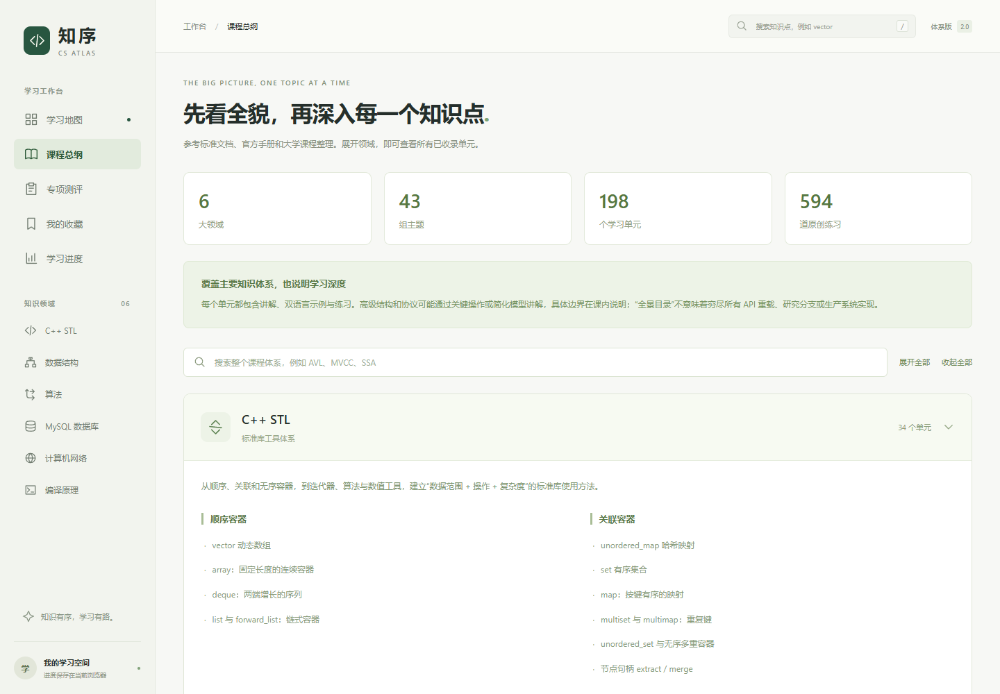

# 知序 · CS Atlas

中文计算机学习网站：6大领域、198节课程、594道原创练习，含C++/Python示例、折叠答案与自选测评。

- [在线学习](https://elysia11110925.github.io/cs-atlas/)
- [下载离线单文件](https://elysia11110925.github.io/cs-atlas/offline.html)（网页页脚也有下载按钮；下载HTML后直接用浏览器打开）
- [完整课程目录与来源](CURRICULUM.md)
- [使用说明与验证范围](GUIDE.md)

## 离线使用

1. 最可靠：下载offline.html，断网后双击打开。外部参考链接仍需网络。
2. 在线版本：首次联网访问，等待页脚“离线缓存已就绪”，此后可在同一浏览器断网访问。清理浏览器缓存或无痕环境可能移除缓存。

进度保存在当前浏览器。在线与本地文件存储空间不同，迁移时请在学习进度页导出/导入。网页不执行C++、Python或SQL，编程题对照答案自评；21节MySQL客户端示例尚未实际连接数据库验证。

## 发布与维护

GitHub Pages从main分支的/docs目录发布。修改docs内课程或界面后提交即可重新发布；修改离线缓存资源时需更新sw.js的CACHE版本。offline.html是独立打包版本，内容更新时也应重新生成。

源码是无需构建的HTML/CSS/JavaScript，全部位于docs。可用任意本地静态服务器预览，或直接打开docs/index.html（Service Worker缓存需要HTTP/HTTPS环境）。

